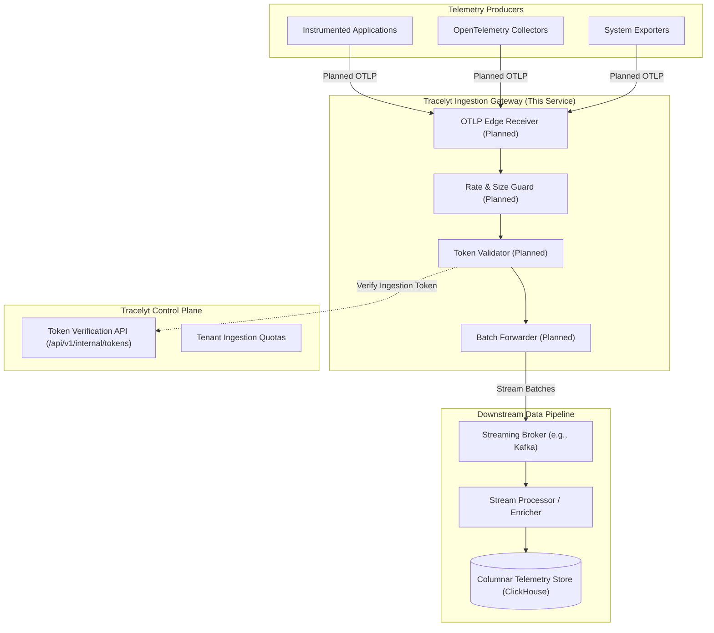

# Tracelyt Ingestion

High-throughput telemetry ingestion entry point for the Tracelyt open-source observability platform.

---

## Project Status

> [!IMPORTANT]
> **Stage: Initial Foundation & Architecture Scaffolding (Pre-1.0)**  
> This repository currently contains the build system, static analysis, containerization, and repository governance foundation.  
> **Telemetry receivers (OTLP/gRPC, OTLP/HTTP), stream pipelines, token verification, and payload processing are intentionally not implemented yet.**

---

## What is Tracelyt Ingestion?

**Tracelyt Ingestion** will eventually serve as the edge gateway for telemetry (distributed traces, metrics, and application logs) emitted by instrumented applications and infrastructure collectors.

Within the wider Tracelyt platform architecture, Ingestion acts as the entry point of the telemetry data plane:
1. **Edge Protocol Termination**: Terminating incoming OpenTelemetry Protocol (OTLP) connections.
2. **Protective Filtering**: Enforcing byte size limits and tenant-allocated rate caps before data reaches internal streaming pipelines.
3. **Token Verification**: Extracting ingestion tokens and validating them against the Tracelyt Control Plane.
4. **Stream Handoff**: Forwarding validated telemetry batches onto distributed streaming message brokers for asynchronous processing.



---

## Current Scope & Explicit Non-Goals

### In Scope (Current Foundation)
- Java 21 LTS runtime and Spring Boot 3.4.3 dependency baseline.
- Apache Maven build lifecycle with official pinned Maven Wrapper 3.3.4 (Maven 3.9.9).
- Checkstyle style enforcement via [.checkstyle.xml](.checkstyle.xml).
- SpotBugs static bytecode defect analysis via `spotbugs-maven-plugin`.
- OWASP Dependency-Check plugin configuration for dependency vulnerability auditing.
- Multi-stage non-root container image definition ([Dockerfile](Dockerfile)).
- Operational Actuator endpoints (`/actuator/health`, `/actuator/info`).
- Deterministic Spring Boot context smoke test.
- Open-source governance files, contributor guidelines, and initial threat model.

### Explicit Non-Goals (Not Implemented in this Repository)
- **No Ingestion Endpoints**: No OTLP/HTTP or OTLP/gRPC listeners are active.
- **No Database Persistence**: Ingestion is a stateless gateway. Relational databases (PostgreSQL) and JPA entities are omitted.
- **No Streaming Producers**: Kafka, Redis, or RabbitMQ messaging integrations are deferred to future milestones.
- **No Telemetry Transformation**: No span parsing, log parsing, metric rollups, or PII redaction logic.
- **No Authentication Handlers**: No token verification logic is present.

---

## Security Boundary Notice

> [!CAUTION]
> **Do Not Expose to Untrusted Traffic**: This service must **not** be exposed to public networks at this stage.  
> Before any telemetry endpoint is exposed, mandatory technical controls must be implemented:
> 1. Ingestion token verification against the Tracelyt Control Plane.
> 2. Strict request body byte caps (4MB default) enforced prior to payload deserialization.
> 3. Per-tenant rate limits and backpressure shed mechanisms.
> 4. Upstream TLS 1.3 termination.

For complete details, review the [Initial Threat Model](docs/security/threat-model.md) and [Deployment Security Guidelines](docs/operations/deployment-security.md).

---

## Technology Stack

| Component | Technology | Version | Purpose |
| :--- | :--- | :--- | :--- |
| **Language** | Java | 21 LTS | High-performance, strongly-typed LTS runtime |
| **Framework** | Spring Boot | 3.4.3 | Application lifecycle and dependency management |
| **Build Tool** | Apache Maven / Wrapper | 3.9.9 / 3.3.4 | Deterministic, reproducible build lifecycle |
| **Operational Probes** | Spring Boot Actuator | 3.4.3 (BOM) | Container health, readiness, and liveness endpoints |
| **Testing** | JUnit 5, AssertJ, Mockito | 3.4.3 (BOM) | Context startup testing and future unit tests |
| **Code Style** | Checkstyle | 10.21.4 | Build-time style checking via [.checkstyle.xml](.checkstyle.xml) |
| **Static Analysis** | SpotBugs | 4.10.3.0 | Bytecode defect and concurrency analysis |
| **Dependency Scanning**| OWASP Dependency-Check | 12.1.0 | Known vulnerability scanning |
| **Container Runtime** | Docker / Temurin | 21-jre-jammy | Multi-stage build running as non-root user (`tracelyt` UID 10001) |

---

## Repository Structure

```
tracelyt-ingestion/
├── .github/                      # GitHub configuration, issue templates, workflows
│   ├── ISSUE_TEMPLATE/           # Structured bug report and feature request forms
│   ├── workflows/                # CI and Dependency Review workflows
│   ├── CODEOWNERS                # Maintainer ownership mappings
│   ├── PULL_REQUEST_TEMPLATE.md  # Standard pull request checklist
│   └── SECURITY.md               # Link to root security disclosure policy
├── docs/                         # In-depth architectural, operational, and security docs
│   ├── architecture/             # Overview, system boundaries, and ADRs
│   ├── development/              # Local setup, testing guide, and code style
│   ├── operations/               # Configuration, health probes, and deployment security
│   └── security/                 # Threat model, secure development, and data handling
├── src/
│   ├── main/
│   │   ├── java/io/tracelyt/ingestion/
│   │   │   └── IngestionApplication.java     # Application entry point
│   │   └── resources/
│   │       └── application.yml               # Safe shared defaults
│   └── test/
│       ├── java/io/tracelyt/ingestion/
│       │   └── IngestionApplicationTest.java # Context smoke test
│       └── resources/
│           └── application-test.yml          # Deterministic test configuration
├── .checkstyle.xml               # Checkstyle rule definitions
├── .dockerignore                 # Exclusions for container builds
├── .editorconfig                 # Formatting rules across IDEs
├── .env.example                  # Documented environment variable template
├── .gitattributes                # Line ending normalization
├── .gitignore                    # Secrets, build, and IDE ignore rules
├── .java-version                 # Pinned Java version (21)
├── .owasp-suppressions.xml       # Dependency-Check suppression file
├── compose.yaml                  # Local container compose configuration
├── Dockerfile                    # Multi-stage non-root container build
├── mvnw / mvnw.cmd               # Official Apache Maven Wrapper scripts
├── pom.xml                       # Maven build descriptor
├── renovate.json                 # Renovate dependency configuration
├── CHANGELOG.md                  # Project version changelog
├── CODE_OF_CONDUCT.md           # Community code of conduct
├── CONTRIBUTING.md               # Contributor guidelines and workflow
├── LICENSE                       # Apache License 2.0 full text
├── NOTICE                        # Attribution notice
├── README.md                     # Project overview and instructions
├── SECURITY.md                   # Vulnerability disclosure policy
├── SUPPORT.md                    # Community support channels
└── THIRD_PARTY_NOTICES.md        # Third-party dependency licenses
```

---

## Prerequisites

- **Java Development Kit (JDK)**: Version 21 LTS (Temurin, Corretto, or Microsoft OpenJDK).
- **Git**: Version 2.30+.
- **Docker**: Optional, for containerized builds.

---

## Getting Started

### 1. Clone the Repository
```bash
git clone https://github.com/Tracelyt-Systems/tracelyt-ingestion.git
cd tracelyt-ingestion
```

### 2. Configure Environment Variables
Copy [.env.example](.env.example) to `.env`:
```bash
# Linux / macOS
cp .env.example .env

# Windows (PowerShell)
Copy-Item .env.example .env
```

| Variable | Description | Required? | Default Value |
| :--- | :--- | :--- | :--- |
| `PORT` | HTTP server listening port | Optional | `8081` |
| `SPRING_PROFILES_ACTIVE` | Active Spring profile | Optional | `default` |
| `MANAGEMENT_ENDPOINTS_WEB_EXPOSURE_INCLUDE` | Exposed Actuator endpoints | Optional | `health,info` |

*Never commit `.env` files containing production secrets to Git.*

---

## Build, Test, and Quality Checks

### Run Full Build & Verification
Executes compilation, Checkstyle, SpotBugs, and unit tests:

**Linux / macOS**:
```bash
./mvnw clean verify
```

**Windows (PowerShell)**:
```powershell
.\mvnw.cmd clean verify
```

### Run Individual Checks
```bash
# Check code style
./mvnw checkstyle:check

# Run SpotBugs static bytecode analysis
./mvnw spotbugs:check

# Run tests only
./mvnw test

# Optional: Run OWASP Dependency-Check
./mvnw dependency-check:check -Psecurity-scan
```

### Run the Application Locally
```bash
# Linux / macOS
./mvnw spring-boot:run

# Windows (PowerShell)
.\mvnw.cmd spring-boot:run
```

Once started, the application listens on port `8081`.

---

## Operational Health Diagnostics

Query Spring Boot Actuator health probes:

```bash
# Process health
curl http://localhost:8081/actuator/health

# Response:
# {"status":"UP"}

# Application info
curl http://localhost:8081/actuator/info
```

*Note: In the current foundation, `/actuator/health` reporting `UP` signifies that the Java process is alive, not that an OTLP ingestion receiver is active.*

---

## Planned Milestones (Roadmap)

- [ ] **Milestone 1**: OTLP/gRPC and OTLP/HTTP receiver interfaces and static protobuf decoders.
- [ ] **Milestone 2**: Ingestion token extraction and validation client against Tracelyt Control Plane.
- [ ] **Milestone 3**: Edge protective guards (4MB request size caps, token-bucket rate limiters).
- [ ] **Milestone 4**: Downstream streaming broker integration (e.g., Kafka batch producer).
- [ ] **Milestone 5**: Backpressure propagation and dynamic readiness probe coupling.

---

## Troubleshooting Common Issues

### 1. Java Version Mismatch
If Maven fails with `release version 21 not supported`, verify that your terminal `JAVA_HOME` points to a JDK 21 installation:
```bash
java -version
```

### 2. Port 8081 Already in Use
If port 8081 is bound by another service, override it in `.env` or via CLI:
```bash
PORT=8082 ./mvnw spring-boot:run
```

### 3. Out of Memory on Constrained Workstations
If running on workstations with limited free physical RAM, cap Maven memory:
```powershell
$env:MAVEN_OPTS = "-Xmx512m -XX:MaxMetaspaceSize=256m"
.\mvnw.cmd clean verify
```

---

## Documentation Index

- [Architecture Overview](docs/architecture/overview.md)
- [System Boundaries](docs/architecture/boundaries.md)
- [Architecture Decision Records (ADRs)](docs/architecture/decisions/README.md)
- [Local Development Setup](docs/development/local-setup.md)
- [Testing Guide](docs/development/testing.md)
- [Code Style & Quality](docs/development/code-style.md)
- [Configuration Reference](docs/operations/configuration.md)
- [Health & Readiness Probes](docs/operations/health-and-readiness.md)
- [Deployment Security](docs/operations/deployment-security.md)
- [Initial Threat Model](docs/security/threat-model.md)
- [Secure Development Practices](docs/security/secure-development.md)
- [Telemetry Privacy & Data Handling](docs/security/data-handling.md)

---

## Contributing & Governance

- [Contributing Guidelines](CONTRIBUTING.md)
- [Code of Conduct](CODE_OF_CONDUCT.md)
- [Security Policy](SECURITY.md)
- [Support Guide](SUPPORT.md)
- [Changelog](CHANGELOG.md)

---

## License

Tracelyt Ingestion is licensed under the [Apache License, Version 2.0](LICENSE).  
Copyright 2026 Tracelyt Authors and Contributors. See [NOTICE](NOTICE) and [THIRD_PARTY_NOTICES.md](THIRD_PARTY_NOTICES.md) for details.
