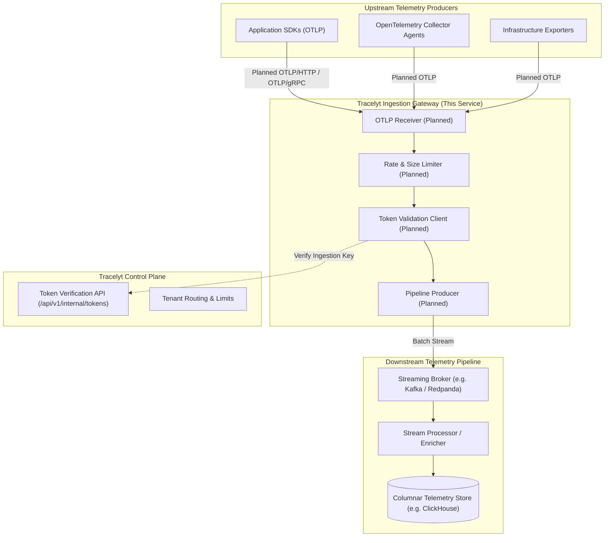

# Architecture Overview: Tracelyt Ingestion

## 1. Role in the Tracelyt Ecosystem

**Tracelyt** is an open-source observability platform designed to collect, process, and analyze telemetry (traces, metrics, and logs) from distributed systems and infrastructure.

Within this ecosystem, **Tracelyt Ingestion** is planned to serve as the edge receiver and ingestion gateway. It will accept incoming telemetry payloads from agent fleets (such as OpenTelemetry Collectors and SDKs), validate tokens with the Tracelyt Control Plane, apply ingestion limits, and forward validated telemetry batches into the downstream stream processing pipeline.

## 2. Current Implementation Status vs. Planned Architecture

> [!IMPORTANT]
> **Foundation Stage Notice**: All telemetry ingestion mechanisms (OTLP receivers, gRPC listeners, payload buffering, streaming producers, and authentication) shown above are **planned capabilities**. The current codebase contains only the application bootstrap lifecycle, operational health endpoints, and build tooling.

| Component / Layer | Current Status | Planned Implementation |
| :--- | :--- | :--- |
| **Runtime & Framework** | Java 21 LTS, Spring Boot 3.4.3 | High-throughput non-blocking runtime |
| **Ingestion Protocol** | None (Actuator endpoints only) | OpenTelemetry Protocol (OTLP/gRPC and OTLP/HTTP) |
| **Authentication** | None | Ingestion key verification against Tracelyt Control Plane |
| **Resource Safeguards** | Default container limits | Request size caps, rate limiting, and backpressure |
| **Downstream Forwarding** | None | Distributed streaming broker integration |
| **Health Probes** | Spring Boot Actuator (`/actuator/health`) | Process liveness, dependency readiness, and pipeline backpressure probes |

## 3. Guiding Architectural Principles

1. **Standards-First**: Use OpenTelemetry standards (OTLP) rather than inventing proprietary telemetry encodings.
2. **Stateless Edge**: The ingestion gateway remains stateless. Telemetry state, indexing, and long-term persistence belong strictly in downstream streaming and columnar systems.
3. **Fail-Fast Ingestion Protection**: Malformed, oversized, or unauthenticated payloads must be rejected immediately at the edge to protect internal processing pipelines.
4. **Separation of Planes**: Ingestion belongs to the telemetry data plane. Organizational metadata, tenant provisioning, and billing belong in the control plane.
